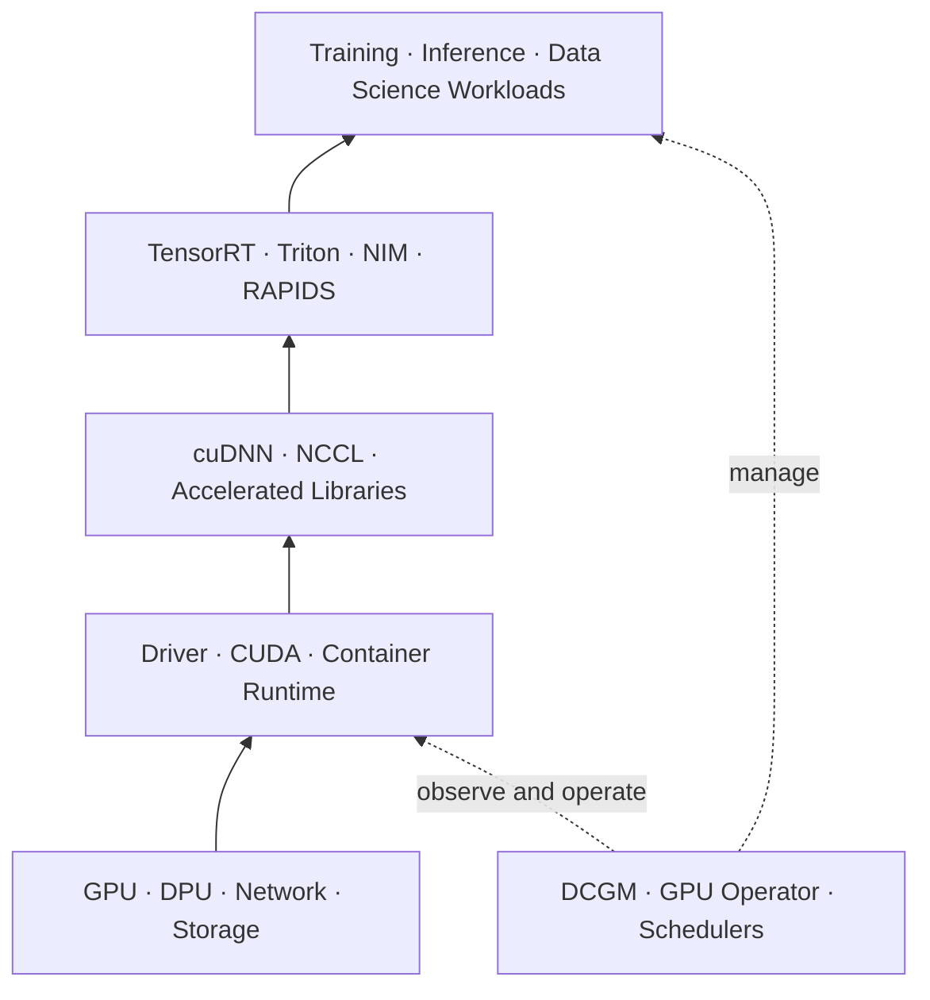

  

<h1 align="center">NVIDIA NCA-AIIO Study Notes</h1>

  An independent, exam-blueprint-aligned path through AI infrastructure and operations.

  
  
  
  

> [!IMPORTANT]
> This is an unofficial learning resource, not an exam dump. It is not affiliated with or endorsed by NVIDIA. Product capabilities and exam details change; verify them with the linked official sources.

## About this guide

This repository turns the official NCA-AIIO blueprint into a practical learning path for system administrators, DevOps engineers, architects, data-center professionals, and anyone entering accelerated computing. It connects foundational AI concepts with the infrastructure that trains and serves models: GPUs, high-speed networking, storage, power, cooling, orchestration, monitoring, and virtualization.

The emphasis is on **choosing the right technology for a scenario**, not memorizing isolated product facts. Every section is designed to help you distinguish tools that sound similar, locate bottlenecks across the stack, and explain trade-offs in plain language.

## Start here

| 1. Find your gaps | 2. Learn by domain | 3. Prove understanding |
|:---:|:---:|:---:|
| [Take the diagnostic →](practice/questions.md) | [Open the study plan →](STUDY-PLAN.md) | [Try the practical labs →](labs/README.md) |
| 15 original scenario questions | Fast 16-hour or four-week route | Observation and design exercises |

## Exam snapshot

Verified **2026-10-22** against the [official certification page](https://www.nvidia.com/en-us/learn/certification/ai-infrastructure-operations-associate/):

| Item | Current detail |
|---|---|
| Level | Associate |
| Format | 50 questions, online proctored |
| Time | 60 minutes |
| Price | USD 125 (check regional pricing) |
| Prerequisite | Basic understanding of data-center infrastructure |
| Validity | Two years |

## Blueprint and suggested study time

| Domain | Exam weight | 16-hour plan |
|---|---:|---:|
| [Essential AI Knowledge](domains/01-essential-ai-knowledge.md) | 38% | 6 hours |
| [AI Infrastructure](domains/02-ai-infrastructure.md) | 40% | 6.5 hours |
| [AI Operations](domains/03-ai-operations.md) | 22% | 3.5 hours |

## How to use this repository

1. Take the [diagnostic quiz](practice/questions.md) without notes.
2. Read the three domain guides in blueprint order.
3. Complete the [hands-on labs](labs/README.md) on any machine with Docker; an NVIDIA GPU is optional.
4. Review every missed question with the [answer explanations](practice/answers.md).
5. Use the [cram sheet](CRAM-SHEET.md) during the final review—not as your only preparation.
6. Recheck the [official NVIDIA page](https://www.nvidia.com/en-us/learn/certification/ai-infrastructure-operations-associate/) before booking.

## Learning objectives

By the end, you should be able to:

- distinguish AI, machine learning, deep learning, training, and inference;
- explain why GPUs suit parallel AI workloads and where CPUs still matter;
- map CUDA, cuDNN, TensorRT, Triton, NIM, DCGM, GPU Operator, and Base Command Manager to their roles;
- reason about compute, memory, storage, power, cooling, and network bottlenecks;
- select among PCIe, NVLink, Ethernet, InfiniBand, GPUDirect RDMA, and GPUDirect Storage;
- explain DPU offload, acceleration, and isolation;
- distinguish MIG, time-slicing, passthrough, and vGPU;
- choose meaningful GPU health, utilization, and workload metrics.

## Top buzzwords and exam cues

Use this as a recognition map. A buzzword is useful only when you can explain the problem it solves and what it does **not** do.

| Buzzword | Plain-English description | Cue to remember |
|---|---|---|
| **Accelerated computing** | CPUs and specialized processors work together so parallel workloads run faster. | Heterogeneous system, not “GPU replaces CPU.” |
| **Training** | A model learns parameters from data using forward and backward passes. | Throughput, memory capacity, collectives, time-to-train. |
| **Inference** | A trained model produces predictions or generated output. | Latency, serving throughput, efficiency, cost per request. |
| **CUDA** | NVIDIA's parallel-computing platform, programming model, runtime, and tools. | Foundation beneath GPU-accelerated libraries and applications. |
| **Tensor Cores** | GPU units optimized for matrix operations and mixed precision. | AI math acceleration, not general cluster management. |
| **cuDNN** | Accelerated building blocks for deep-neural-network operations. | Framework-level neural-network primitives. |
| **TensorRT** | Optimizes and executes trained models for efficient inference. | Optimize inference; it is not a scheduler or monitoring tool. |
| **Triton Inference Server** | Serves models from multiple frameworks with batching and model management. | Model serving and APIs. |
| **NIM** | Packaged, supported inference microservices with standard APIs. | Faster deployment of optimized inference services. |
| **NCCL** | Library for collective communication across GPUs and nodes. | All-reduce and distributed training communication. |
| **NVLink / NVSwitch** | High-bandwidth connectivity among supported GPUs inside a system. | Scale-up communication. |
| **InfiniBand / Ethernet** | Fabrics connecting nodes, storage, and services across a cluster. | Scale-out communication. |
| **RDMA / RoCE** | Direct remote-memory access with low CPU overhead; RoCE carries it over Ethernet. | Low-latency data movement across the network. |
| **GPUDirect RDMA** | A supported PCIe device, commonly a NIC, exchanges data directly with GPU memory. | GPU ↔ NIC/device. |
| **GPUDirect Storage** | Storage transfers data directly to or from GPU memory on a supported path. | GPU ↔ storage. |
| **DPU / BlueField** | Dedicated infrastructure processor for networking, storage, and security services. | Offload, accelerate, isolate. |
| **MIG** | Hardware partitions a supported GPU into isolated instances. | Predictable partitioning and isolation. |
| **Time-slicing** | Multiple workloads share a GPU by taking turns. | Concurrency without MIG-equivalent memory or fault isolation. |
| **DCGM** | GPU telemetry, health, diagnostics, topology, and job statistics. | Observe GPU fleets. |
| **GPU Operator** | Automates the NVIDIA GPU software lifecycle in Kubernetes. | Drivers, device plugin, Container Toolkit, DCGM Exporter—not autoscaling. |
| **Slurm / Kubernetes** | Schedulers and orchestrators that place and manage workloads. | Resource requests, queues, policy, topology, placement. |
| **PUE** | Total facility energy divided by IT-equipment energy. | Facility efficiency; closer to 1 is better. |
| **Data gravity** | Large datasets are costly or slow to move, influencing compute location. | Cloud vs on-premises and storage decisions. |
| **MLOps** | Repeatable practices for versioning, deploying, monitoring, and governing models. | The complete model lifecycle, not only training. |

> **Fast recall:** DCGM observes, GPU Operator installs and maintains, the scheduler places work, TensorRT optimizes inference, Triton serves models, and NCCL moves collective data.

## The platform in one picture

The exam rewards knowing both the layers and their boundaries: optimization is not serving, monitoring is not scheduling, and GPU enablement is not application autoscaling.

## Repository map

- [`STUDY-PLAN.md`](STUDY-PLAN.md) — two practical schedules
- [`domains/`](domains/) — blueprint-aligned study notes
- [`practice/`](practice/) — original questions and explained answers
- [`labs/`](labs/) — safe observation exercises
- [`CRAM-SHEET.md`](CRAM-SHEET.md) — last-day comparisons
- [`GLOSSARY.md`](GLOSSARY.md) — high-frequency terms
- [`resources/SOURCES.md`](resources/SOURCES.md) — primary sources and freshness notes

## Integrity and scope

All questions here are original and test public concepts. Do not contribute recalled live-exam questions, proprietary course screenshots, answer dumps, or confidential material. Exact product specifications are deliberately kept out of the core notes unless they illustrate a concept; always verify current product documentation.

<strong>Why this guide avoids memorizing long specification tables</strong>

Product limits change across architectures and software releases. The notes teach durable selection cues first, then point to primary documentation for current limits. That makes the guide useful beyond a single exam revision.

## License

Text and original diagrams are licensed under [CC BY 4.0](LICENSE). NVIDIA product names are trademarks of their respective owner.
