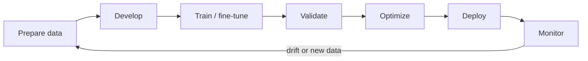

# Domain 1 — Essential AI Knowledge (38%)

> **Outcome:** Explain the AI lifecycle, compare training with inference, and place each major NVIDIA software component at the correct layer.

**Blueprint coverage:** software stack · training vs inference · AI/ML/DL · use cases · NVIDIA solutions · development lifecycle · CPU vs GPU

## 1. AI, ML, and DL

- **Artificial intelligence** is the broad goal of systems performing tasks associated with human intelligence.
- **Machine learning** is an AI approach that learns patterns from data rather than relying only on hand-written rules.
- **Deep learning** is ML based on multi-layer neural networks. It commonly benefits from GPU parallelism.

Generative AI creates new content; it is a use case, not a synonym for all AI. Common workloads include computer vision, natural-language processing, recommendations, speech, forecasting, robotics, digital twins, and drug discovery.

## 2. Training versus inference

| Concern | Training | Inference |
|---|---|---|
| Goal | Learn model parameters | Use a trained model |
| Typical priority | Throughput, scale, time-to-train | Latency, throughput, cost per request |
| Data flow | Repeated forward/backward passes | Usually forward pass only |
| Memory | Parameters, activations, gradients, optimizer state | Parameters plus runtime state/cache |
| Scaling | Often multi-GPU/multi-node | From edge to large serving clusters |

These are tendencies, not laws. Batch inference may maximize throughput; real-time distributed training can also be latency-sensitive.

## 3. CPU versus GPU

A CPU has a small number of sophisticated cores optimized for serial work, branching, operating-system duties, and general-purpose latency. A GPU has many parallel execution units and high memory bandwidth, making it effective for the repeated matrix/tensor operations used by AI.

A useful model is **heterogeneous computing**: the CPU orchestrates and handles control-heavy work; the GPU accelerates highly parallel work. Tensor Cores accelerate mixed-precision matrix operations. Reduced precision can improve speed and capacity when accuracy remains acceptable.

## 4. The NVIDIA software stack

Think from hardware upward:

```text
Applications and workflows
NIM / Triton / application frameworks
TensorRT / RAPIDS / domain SDKs
cuDNN and accelerated libraries
CUDA platform and runtime
Driver + container runtime integration
GPU / DPU / network hardware
```



Key distinctions:

| Component | Primary role |
|---|---|
| CUDA | Parallel-computing platform, programming model, runtime, and tools |
| cuDNN | GPU-accelerated primitives for deep neural networks |
| TensorRT | Optimizes and executes inference |
| Triton Inference Server | Serves models from multiple frameworks at scale |
| NIM | Packaged, supported inference microservices with standard APIs |
| RAPIDS | GPU-accelerated data-science libraries |
| NCCL | Multi-GPU/multi-node collective communication |
| AI Enterprise | Enterprise software suite, support, and validated deployment options |

## 5. Model lifecycle

The simplified lifecycle is: collect/prepare data → develop model → train/fine-tune → validate → optimize → deploy → monitor → retrain or retire.

MLOps makes that lifecycle repeatable through versioning, pipelines, registries, deployment automation, observability, governance, and drift monitoring. Containers improve portability, but the host still needs a compatible driver and container runtime integration.

## 6. Solution selection cues

- **Need faster inference?** Think TensorRT for optimization; Triton or NIM for serving/packaging.
- **Need collective GPU communication?** Think NCCL and a fast scale-out fabric.
- **Need GPU data science?** Think RAPIDS.
- **Need GPU telemetry and diagnostics?** Think DCGM.
- **Need Kubernetes GPU software lifecycle?** Think GPU Operator.

## Self-check

1. Why does adding GPUs not automatically accelerate control-heavy serial code?
2. How do TensorRT and Triton differ?
3. Which state makes training generally more memory-intensive than inference?
4. Why is “inference always prioritizes latency” an unsafe absolute?

<p align="right"><a href="../README.md">↑ Back to guide</a> · <a href="02-ai-infrastructure.md">Next: AI Infrastructure →</a></p>
