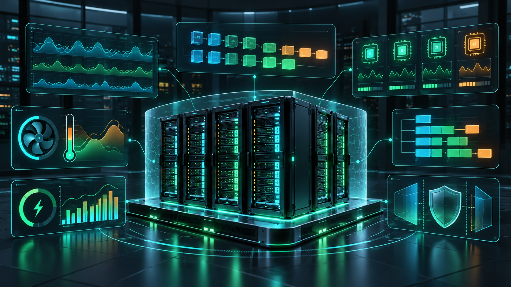

# Domain 3 — AI Operations (22%)

  

> **Outcome:** Choose appropriate management, monitoring, scheduling, troubleshooting, and virtualization approaches for accelerated infrastructure.

**Blueprint coverage:** data-center management · monitoring · orchestration · job scheduling · GPU metrics · virtualization

## 1. Observe the whole system

Monitor facilities, nodes, fabric, storage, GPUs, schedulers, and applications. A low GPU-utilization symptom can originate in storage, networking, CPU preprocessing, batch size, synchronization, placement, or the application itself.

GPU signals include utilization, memory use, memory bandwidth activity, temperature, power, clocks, throttling reasons, ECC errors, XID events, interconnect counters, and process/job attribution. Alert on conditions that require action; use trends and workload context instead of one isolated metric.

## 2. Tool boundaries

| Tool | Main responsibility |
|---|---|
| `nvidia-smi` / NVML | Local querying and management interface |
| DCGM | Fleet-oriented GPU telemetry, health, diagnostics, topology, and job stats |
| DCGM Exporter | Exposes DCGM metrics for Prometheus |
| Base Command Manager | Cluster provisioning and lifecycle/management workflows |
| GPU Operator | Automates NVIDIA GPU software components in Kubernetes |
| Kubernetes scheduler | Places pods subject to resources and constraints |
| Slurm | Schedules jobs and allocates HPC/AI cluster resources |

The GPU Operator installs and manages GPU-enablement components. It is not the Horizontal Pod Autoscaler and does not add cluster nodes in response to application demand.

## 3. Scheduling and orchestration

Schedulers match resource requests to available resources, enforce policy, and queue work. Good operation requires accurate requests, topology awareness, quotas, priorities, isolation, and accounting. Multi-node jobs may need gang scheduling so all required workers start together.

Containers package applications and dependencies. Kubernetes orchestrates containerized services; Slurm is common for batch and tightly coupled HPC/AI work. They can coexist, and neither label alone guarantees efficient GPU utilization.

## 4. GPU sharing and virtualization

| Method | Isolation | Typical use |
|---|---|---|
| Passthrough | Strong VM ownership of a physical GPU | Maximum direct access |
| vGPU | Mediated virtual GPU profiles | VM consolidation with vendor stack |
| MIG | Hardware-partitioned GPU resources on supported GPUs | Predictable isolated slices |
| Time-slicing | Shared execution over time | Higher concurrency with weak isolation |

MIG provides dedicated resource partitions and fault isolation; time-slicing does not provide the same memory or fault isolation. Capabilities and instance counts depend on the exact GPU and software release—verify current support tables.

## 5. Troubleshooting sequence

1. Define impact, scope, and recent changes.
2. Check scheduler/job state and application logs.
3. Compare GPU, CPU, memory, storage, and network timelines.
4. Inspect health events, temperatures, power, throttling, and errors.
5. Validate topology and placement assumptions.
6. Reproduce safely, isolate one variable, and document the result.

Avoid treating 100% utilization as universally good or low utilization as universally bad. The objective is service-level performance, reliability, and useful work per cost—not a single dashboard number.

## Self-check

1. What evidence distinguishes thermal throttling from input starvation?
2. Why does GPU Operator not replace an autoscaler?
3. When would MIG be preferable to time-slicing?
4. What does a scheduler need to place a multi-node job well?

<a href="02-ai-infrastructure.md">← AI Infrastructure</a> · <a href="../README.md">↑ Back to guide</a>

